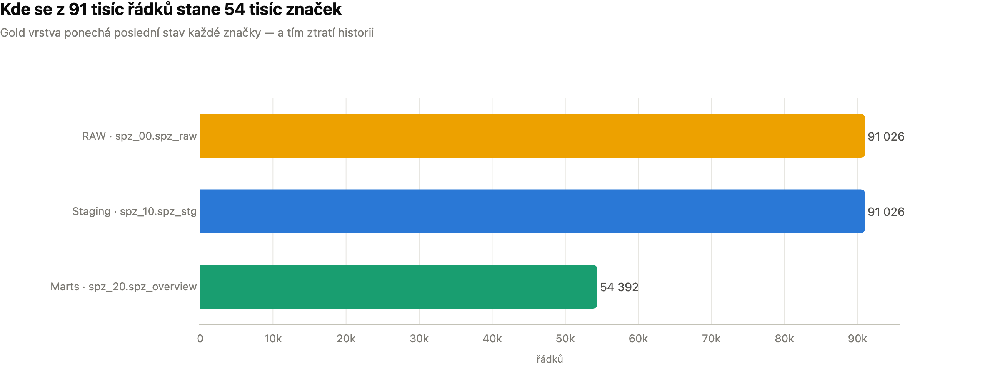
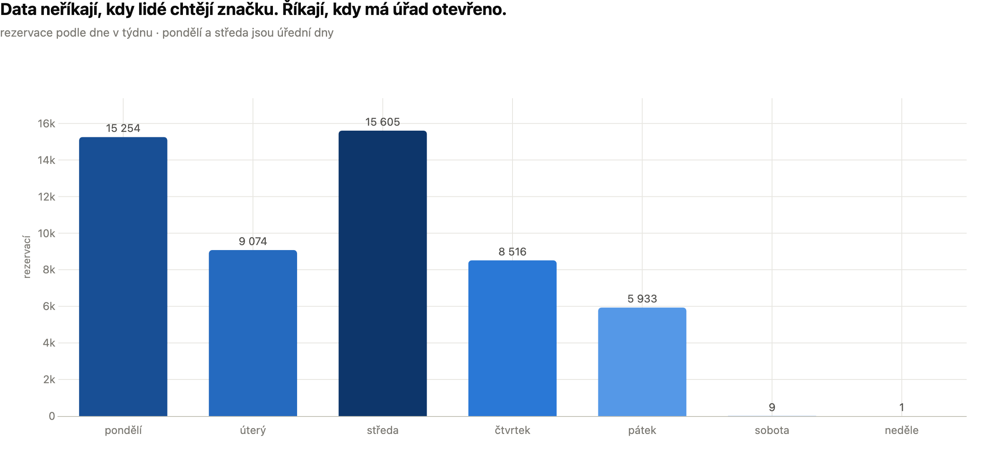

Nejčastější znak v celém registru českých registračních značek na přání není
písmeno. Je to **nula** — objeví se 51 472krát, zatímco nejsilnější písmeno A
jen 30 092krát.

Není to záliba v číslech. Písmena **G, O, Q a W** se na značku na přání použít
nesmí a v datech to jde ověřit doslova: napříč 54 392 značkami se nevyskytují
ani jednou. Kdo chce mít na autě `BOSS`, napíše `B0SS`. Kdo chce `MOTOR`,
napíše `M0T0R`. Nula tu není číslice, ale náhradní písmeno.


Tohle zjištění má praktický důsledek pro celou analýzu: **jakýkoli pokus číst
text značky přímo je odsouzený k tomu, že polovinu slov nenajde.** Značku je
potřeba nejdřív dekódovat zpátky.

Postavil jsem nad těmi daty end-to-end pipeline a dashboard. Níže je popis
stacku, návrh datového modelu a několik věcí, které z dat vypadly — včetně dvou
„chyb“, které se po prověření ukázaly být mým nepochopením zdroje.

**[→ Repozitář na GitHubu](https://github.com/tomlukavec/spz-na-prani)**
<!-- Až bude aplikace nasazená na Streamlit Cloudu, doplň sem odkaz:
     · **[→ Živý dashboard](https://ADRESA.streamlit.app)** -->

## Data

[Portál dopravy](https://www.dataovozidlech.cz) publikuje sadu *Seznam RZ na
přání* jako otevřená data: CSV o velikosti asi 10 MB, kódování `cp1250`,
historie od ledna 2016, kdy si u nás řidiči začali moct kupovat vlastní text na
značku.

Jeden řádek není jedna značka. Je to **jedna epizoda** — konkrétní značka na
konkrétním vozidle v konkrétním období. Celkem 91 026 epizod nad 54 392
unikátními značkami. Ten rozdíl je podstatný a vrátím se k němu.

Ke každému řádku je text značky, pět časových razítek (rezervace, přidělení
k vozidlu, vydání, ukončení, uložení na registru), výrobce a model vozidla
a kód registračního místa. Žádná osobní data — žádná jména majitelů, žádné VIN.

## Stack a proč právě takový

```
Portál dopravy → RAW (spz_00) → Staging (spz_10) → Marts (spz_20) → Dashboard
   CSV, cp1250     Mage.ai          dbt                dbt            Streamlit
```

**Mage.ai** na orchestraci a extrakci, **BigQuery** jako sklad, **dbt** na
transformace, **Streamlit** na prezentační vrstvu. Data mají 91 tisíc řádků, což
se vejde do Excelu — takže volba stacku není o objemu, ale o třech vlastnostech:
transformace jsou verzované v gitu, mají testovatelné mezivrstvy a celé to jde
spustit znovu jedním příkazem.

Model drží **medailonovou architekturu** a hranice mezi vrstvami je záměrná.

**RAW** je věrný log zdroje. Všechno jde do BigQuery jako `STRING` a `NaN` se
převádí na prázdný řetězec — jinak by se do skladu dostal text „nan“ a nikdo by
už nepoznal, jestli šlo o chybějící hodnotu nebo o data. RAW vrstva nic
neinterpretuje, protože v momentě, kdy začne, přestane být auditovatelná.

**Staging** typuje a čistí. České datum `DD.MM.YYYY H:MM:SS` se parsuje přes
`SAFE.PARSE_TIMESTAMP` (bez `SAFE.` by jeden divný řádek shodil celý model)
a prázdné řetězce se zanořeným `NULLIF` mění na skutečné `NULL`.

**Marts** je golden record. Klauzule
`QUALIFY ROW_NUMBER() OVER (PARTITION BY plate_id ORDER BY reserved_at DESC) = 1`
ponechá poslední stav každé značky.



A právě tady je nejdůležitější rozhodnutí celého projektu. Ta deduplikace není
technický detail, je to **volba granularity, která mění, na co se dá ptát**:

- „Kolik existuje značek na přání?“ → **Marts**, 54 392.
- „Jak dlouho značka vydrží na jednom autě?“ → **Staging**, protože Marts
  historii z definice nevidí.

Dashboard proto čte obě vrstvy podle otázky, ne podle toho, která je
„novější“. Kdybych na životní cyklus použil Marts, dostal bych čísla, která
vypadají věrohodně a jsou špatná — a to je horší než chyba, která spadne.

## Dashboard

Nad Marts vrstvou jde dopočítat sémantika, která by v SQL byla neohrabaná:
dekódování číslic zpátky na písmena, morfologie textu značky (podíl číslic,
palindromy, opakování), typologie vozidel a tématický slovník o 470 heslech.
Nad 14 sloupci Gold vrstvy tak vzniká 55 dalších.

Aplikace má jedenáct listů ve třech úrovních, což byla reakce na první verzi —
ta měla dvanáct KPI na obrazovku a byla nečitelná:

- **Příběh** (4 listy) — jedna otázka, jedna linka, maximálně čtyři metriky.
- **Detailní analýza** (5 listů) — kohorty, koncentrace úřadů, Kaplanova–Meierova
  křivka přežití značky na vozidle, Sankey přechodů mezi vozy.
- **Data** (2 listy) — lineage vrstev, kontroly kvality, řádkový průzkumník
  s exportem.

Vizuální systém stojí na jednom pravidle: **barva nese význam, ne dekoraci.**
Osm pevných kategoriálních slotů, které se nikdy necyklují (devátá kategorie se
slévá do neutrální „Ostatní“), magnituda jednou sekvenční rampou, polarita
divergentním párem. Obě palety, světlá i tmavá, prošly kontrolou barvosleposti —
nejhorší sousední dvojice má ΔE 8,4 v OKLab, práh je 8. Žádný graf nemá dvě
osy y.

## Co v datech je

**Poptávka roste každý rok.** Z 3 030 nových rezervací v roce 2016 na 9 459
v roce 2025 — složený roční růst 13,5 %. Ani jeden rok nepřinesl pokles. Ten
skok na začátku grafu je spuštění registru: v lednu 2016 se za měsíc rezervovalo
přes tisíc značek, pak poptávka spadla a k té hodnotě se vrátila až po deseti
letech.

**Nejde o auto pro každého.** Nejprodávanější domácí Škoda je v registru až
třetí — před ní jsou Mercedes-Benz a BMW. Prémiový segment drží 40,5 % značek,
což je násobek jeho zastoupení na českých silnicích.

**Dva úřady vydají skoro pětinu značek.** Praha a Černošice dohromady 17,7 %,
přestože registračních míst je 207. Černošice v žebříčku předbíhají Brno
i Ostravu — na město té velikosti nepoměr, který dává smysl jen tak, že si tam
pro značku jezdí i lidé odjinud. Registr si totiž řidič vybírá, není vázaný na
bydliště. Mezi nejrychlejším a nejpomalejším úřadem je rozdíl v mediánu vyřízení
v řádu týdnů.

**A pak zjištění, které nevypovídá o řidičích, ale o datech:**



Pondělí a středa drží 57 % všech rezervací. To nejsou dny, kdy Čechy napadne
pořídit si značku — to jsou **úřední dny registrů vozidel**. V hodinovém
rozpadu je vidět i pauza na oběd. Časová razítka nepopisují poptávku, ale
provozní dobu úřadu. Vypadá to jako drobnost, ale je to rozdíl mezi „lidé chtějí
značky v pondělí“ a „úředníci je v pondělí zapisují“.

## Kde jsem se mýlil

Nejužitečnější část projektu byla revize deseti kontrol datové kvality. Dvě
z nich totiž nebyly chyby ve zdroji, ale moje chyby v interpretaci.

**„8 535 značek nemá 8 znaků.“** Vypadalo to na poškozené řádky. Po rozpadu
podle typu vozidla je jasné, o co jde: sedm znaků má 99 % motocyklů, ale jen 7 %
ostatních vozidel. Motocyklová tabulka je menší, tedy o znak kratší. Není to
anomálie, je to **druhý povolený formát** — a filtr, kterým jsem si „čistil“
data, mi tichým způsobem odstraňoval všechny motorky.

**„11 867 značek je v depozitu bez ukončení.“** Pole `datum_ulozeni_na_rm`
jsem četl jako fyzické uložení tabulky na registru. U 97,6 % epizod se ale
přesně rovná datu rezervace té *následující* epizody a jen 8 z 54 tisíc
aktuálních záznamů ho má vyplněné. Chová se tedy jako `valid_to` řádku ve stylu
pomalu se měnící dimenze. Celá sekce o depozitu byla postavená na špatném
předpokladu; skutečnou dobu, kdy značka nejezdí, je potřeba počítat jako rozdíl
mezi ukončením na jednom voze a vydáním na dalším.

Třetí nález byl artefakt granularity. **„501 značek bylo ukončeno dřív, než byly
vydány.“** Pole `datum_ukonceni` má ve 100 % případů čas 00:00:00 — zdroj u něj
eviduje jen datum, zatímco vydání nese plný čas. U značky vydané a týž den
ukončené proto rozdíl razítek vycházel jako minus jeden den. Po přepočtu na
kalendářní dny zbývá 124 skutečně nekonzistentních epizod.

**Skutečných chyb zdroje jsou tři řádky z 91 tisíc**: jedna pětiznaková značka
a dvě ukončení s datem před vznikem registru (1993 a 2015). Na velikost sady je
to pozoruhodně čistý zdroj — ale trvalo mi to zjistit až ve chvíli, kdy jsem
každý nález prověřil proti datům místo toho, abych ho jen spočítal.

Z toho plyne jediné použitelné pravidlo: **kontrola kvality, která jen počítá
podezřelé řádky, je k ničemu.** Musí u každého nálezu odpovědět, jestli je to
chyba, nebo vlastnost zdroje, kterou jsem nepochopil. Na listu *Datový model
a kvalita* proto má každá kontrola verdikt a rozklikávací důkaz.

## Nasazení

Aplikace je na Streamlit Community Cloudu, který dává 1 GB paměti — a první
verze se do toho nevešla. Načtení datového modelu mělo peak 642 MB RSS
a stačilo přenačtení stránky, aby kontejner spadl.

Řešení nebylo optimalizovat výpočty, ale **přestat v paměti držet věci, které
se nepoužívají**. Surové vrstvy se držely celé, přitom z nich dashboard
potřeboval jen počty řádků a úplnost sloupců — nahradily je předpočítané
souhrny. K tomu odpadly nepoužívané sloupce, seznam nalezených slov se ukládá
jako řetězec místo Python seznamu a části časových razítek dostaly `Int8`
místo `Int64`. Rámce 106 → 48 MB, serializovaná cache 92 → 48 MB, peak
450 MB.

Za pád byl přitom původně obviněný přepínač světlého režimu — ten totiž
přepisoval `localStorage` a načítal stránku znovu, což se na Cloudu dostalo do
smyčky. Skutečná příčina byla ta paměť; přepínač byl jen spouštěč. Přepínání
teď obstarává nativní nabídka Streamlitu, která navíc obarví i mřížku
`st.dataframe` — ta se kreslí do canvasu a vlastním CSS na ni nedosáhnete.

V repozitáři je i parquet snímek všech tří vrstev, takže se dashboard spustí
bez jakýchkoli přihlašovacích údajů:

```bash
git clone https://github.com/tomlukavec/spz-na-prani.git
cd spz-na-prani && pip install -r requirements.txt
streamlit run dashboard/app.py
```

## Co bych udělal jinak

**Ověřoval bych význam polí dřív.** Obě moje chybné interpretace by se odhalily
během deseti minut, kdyby si na začátku každé pole prošlo kontrolou „co znamená
a čemu se rovná u navazujících řádků“. Místo toho jsem je našel až po tom, co
na nich stála celá sekce dashboardu.

**Neřešil bych paměť až po pádu.** Že se 91 tisíc řádků nevejde do 1 GB, zní
absurdně — dokud si člověk nevšimne, že pandas si k tomu přibere pyarrow,
Streamlit serializuje cache a `st.cache_data` drží kopii navíc.

**Nepsal bych vlastní přepínač tématu.** Dvakrát jsem se snažil obejít něco, co
framework umí sám a lépe, protože jeho verze byla schovaná v menu.

---

*Data: [Portál dopravy](https://www.dataovozidlech.cz), Ministerstvo dopravy ČR,
sada Seznam RZ na přání, stav k 21. 8. 2026. Kód je
[na GitHubu](https://github.com/tomlukavec/spz-na-prani).*
