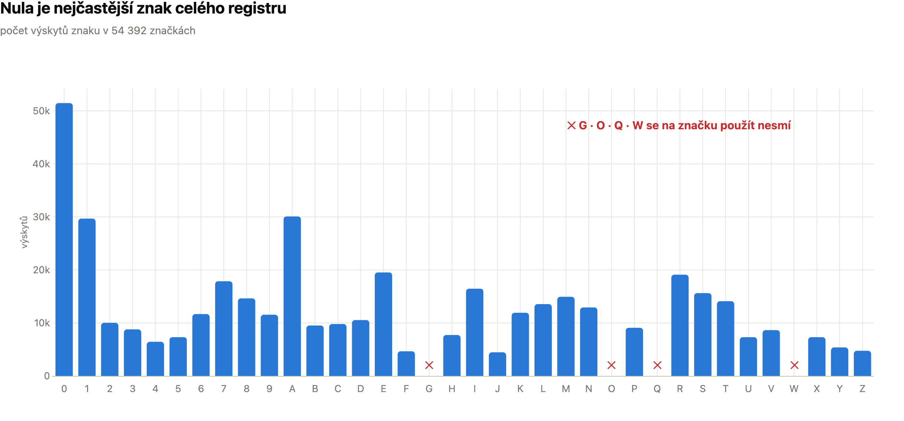
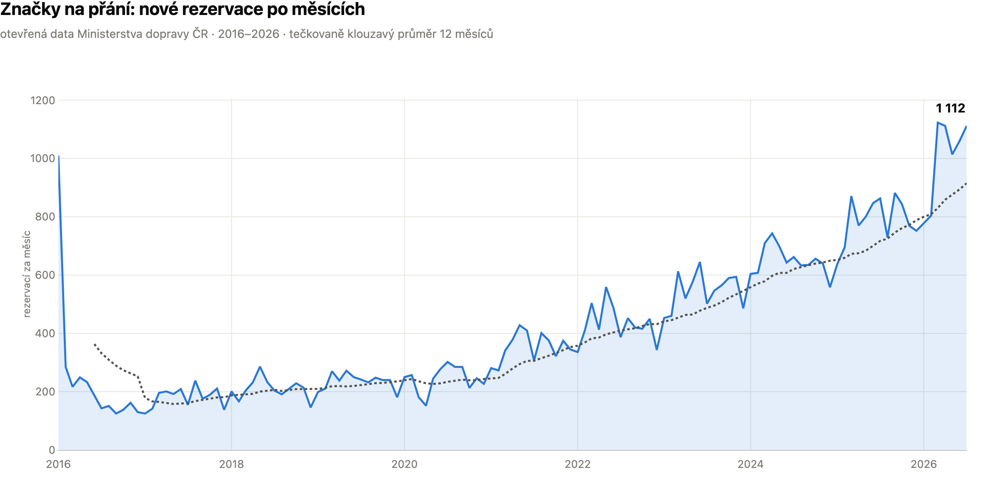

V Uherském Brodě si někdo koupil deset registračních značek najednou:
`B0B0BUS0` až `B0B0BUS9`. Nejsou na autech. Jsou na Neoplanech, Karosách
a Irisbusech, protože si někdo prostě označkoval celou autobusovou flotilu tak,
aby to bylo z dálky vidět.

O sto kilometrů dál v Kladně existuje značka `AUT0BLAU`, která za osm let
vystřídala **28 vozidel**. Skoro všechna byla Fordy: Mondeo, Galaxy, S-MAX,
Edge, pak znovu Edge. To není auto nadšence, ale předváděcí značka autosalonu,
která se přendává z jednoho testovacího vozu na druhý.

A v Brně je série `ESSENS00` až `ESSENS09`, firemní flotila, ve které se vedle
šesti BMW mihne Lamborghini a Rolls-Royce.

Značka na přání se tváří jako projev individuality. V datech je z ní ale často
něco úplně jiného: reklama, správa flotily nebo provozní nástroj. A protože
Ministerstvo dopravy celý registr publikuje jako otevřená data, jde si to
spočítat.

Postavil jsem nad tím pipeline a dashboard.

**[→ Živý dashboard](https://spz-na-prani.streamlit.app/)** &nbsp;·&nbsp;
**[→ Kód na GitHubu](https://github.com/tomlukavec/spz-na-prani)**

## Co je to za data

[Portál dopravy](https://www.dataovozidlech.cz) publikuje sadu *Seznam RZ na
přání*: CSV o velikosti asi 10 MB, kódování `cp1250`, historie od ledna 2016,
kdy si u nás řidiči začali moct kupovat vlastní text na tabulku.

Hned první věc, kterou je potřeba pochopit, je **granularita**. Jeden řádek není
jedna značka, ale jedna *epizoda*, tedy konkrétní značka na konkrétním vozidle
v konkrétním období. Proto má `AUT0BLAU` v datech třicet řádků a proto je v sadě
91 026 epizod, ale jen 54 392 unikátních značek.

Ten rozdíl není detail. Určuje, na co se dá vůbec ptát:

- *„Kolik existuje značek na přání?“* Odpověď je 54 392, na úrovni značky.
- *„Jak dlouho značka vydrží na jednom autě?“* To už se musí ptát epizod,
  protože tabulka o unikátních značkách historii z definice nevidí.

Ke každému řádku je text značky, pět časových razítek (rezervace, přidělení
k vozidlu, vydání, ukončení, uložení na registru), výrobce a model vozidla
a kód registračního místa. Žádná osobní data, žádná jména majitelů, žádné VIN.

## Nula není číslice

Nejčastější znak celého registru není písmeno. Je to **nula**: objeví se
51 472krát, zatímco nejsilnější písmeno A jen 30 092krát.



Vysvětlení je v grafu vidět na první pohled. Písmena **G, O, Q a W** se na
značku na přání použít nesmí a data to potvrzují doslova. Napříč 54 392
značkami se nevyskytují ani jednou. Kdo chce mít na autě `BOSS`, napíše `B0SS`.
Kdo chce `MOTOR`, napíše `M0T0R`. Nula tu není číslo, ale náhradní písmeno.
Stejnou roli hraje šestka místo G.

To má praktický důsledek pro celou analýzu: **kdo čte text značky přímo, přijde
o polovinu slov.** Značku je potřeba nejdřív dekódovat zpátky, a přesně to
dashboard dělá, ve dvou variantách. Konzervativní nahrazuje jen náhrady za
zakázaná písmena (`0`→O, `6`→G), volnější všechny vizuálně podobné číslice
(`3`→E, `4`→A, `5`→S a další). Slova se pak hledají v obou.

Po dekódování má slovníkovou shodu 10,4 % značek. Zbytek nejsou nezajímavé
texty, ale iniciály, data narození nebo jména firem, které žádný obecný slovník
nerozpozná. Skutečná hranice čitelnosti registru je tedy podstatně výš, než kam
dosáhne automat.

## Poptávka roste každý rok



Z 3 030 nových rezervací v roce 2016 na 9 459 v roce 2025, tedy složený roční
růst **13,5 %**. Ani jeden rok nepřinesl pokles a poslední tři roky byly
nejsilnější.

Ten skok na začátku grafu je spuštění registru. V lednu 2016 se za jediný měsíc
rezervovalo přes tisíc značek, pak poptávka spadla na pětinu a k té úvodní
hodnotě se vrátila až po deseti letech.

Z rezervace se přitom značka na vozidle stane v 91 % případů, medián čekání je
**deset dní** a 82 % značek v registru právě někde jezdí.

## Kdo si je pořizuje

Nejde o auto pro každého. Nejprodávanější domácí Škoda je v registru až
**třetí**, před ní jsou Mercedes-Benz a BMW. Prémiový segment drží 40,5 %
značek, což je násobek jeho zastoupení na českých silnicích. Značka na přání se
kupuje k autu, na které chce být majitel vidět.

Zajímavá je i geografie. Praha a Černošice vydají dohromady **17,7 %** všech
značek, přestože registračních míst je 207. Černošice v žebříčku předbíhají Brno
i Ostravu. Na město té velikosti je to nepoměr, který dává smysl jen tak, že si
tam pro značku jezdí i lidé odjinud. Registrační místo si totiž řidič vybírá,
není vázaný na bydliště. A mezi nejrychlejším a nejpomalejším úřadem je rozdíl
v mediánu vyřízení v řádu týdnů.

Devět procent značek nakonec skončí na motorce, a ty mají tabulku o znak kratší,
sedm znaků místo osmi. Kdo si data „vyčistí“ filtrem na osmiznakový formát,
tichým způsobem si odmaže všechny motocykly.

## Jak je to postavené

```
Portál dopravy → RAW (spz_00) → Staging (spz_10) → Marts (spz_20) → Dashboard
   CSV, cp1250     Mage.ai          dbt                dbt            Streamlit
```

**Mage.ai** na orchestraci a extrakci, **BigQuery** jako sklad, **dbt** na
transformace, **Streamlit** na prezentační vrstvu.

Data mají 91 tisíc řádků, což by se vešlo do Excelu. Volba stacku tedy není
o objemu, ale o třech věcech: transformace jsou verzované v gitu, mají
testovatelné mezivrstvy a celé to jde spustit znovu jedním příkazem.

Model drží **medailonovou architekturu** a hranice mezi vrstvami je záměrná.


**RAW** je věrný log zdroje. Všechno jde do BigQuery jako `STRING` a `NaN` se
převádí na prázdný řetězec, protože jinak by se do skladu dostal text „nan“
a už by nikdo nepoznal, jestli šlo o chybějící hodnotu, nebo o data. RAW vrstva
nic neinterpretuje. V momentě, kdy by začala, přestala by být auditovatelná.

**Staging** typuje a čistí. České datum `DD.MM.YYYY H:MM:SS` se parsuje přes
`SAFE.PARSE_TIMESTAMP`, protože bez toho `SAFE.` by jeden divný řádek shodil
celý model. Prázdné řetězce a texty `None` se zanořeným `NULLIF` mění na
skutečné `NULL`.

**Marts** je golden record. Klauzule
`QUALIFY ROW_NUMBER() OVER (PARTITION BY plate_id ORDER BY reserved_at DESC) = 1`
ponechá poslední stav každé značky. Právě tady se z 91 tisíc epizod stane
54 tisíc značek a právě tady se ztratí historie, kterou pak potřebuje list
o životním cyklu. Dashboard proto čte obě vrstvy podle otázky, nikoli podle
toho, která je „novější“.

Jedna vrstva se dopočítává až v Pythonu, protože v SQL by byla neohrabaná. Nad
14 sloupci Marts vrstvy vzniká 55 dalších: dekódování číslic, morfologie textu
(podíl číslic, palindromy, nejdelší opakování znaku), typologie vozidel
a tématický slovník o 470 heslech.

## Dashboard

Aplikace má jedenáct listů ve třech úrovních. To je poučení z první verze, která
měla dvanáct KPI na obrazovku a nedala se číst:

- **Příběh** (4 listy): jedna otázka, jedna linka, maximálně čtyři metriky.
- **Detailní analýza** (5 listů): kohorty, koncentrace úřadů, Kaplanova a Meierova
  křivka přežití značky na vozidle, Sankey přechodů mezi vozy.
- **Data** (2 listy): lineage vrstev, deset kontrol datové kvality s verdiktem
  a rozklikávacím důkazem, řádkový průzkumník s exportem do CSV.

Vizuální systém stojí na jednom pravidle: **barva nese význam, ne dekoraci.**
Osm pevných kategoriálních slotů, které se nikdy necyklují, přičemž devátá
kategorie se slévá do neutrální „Ostatní“. Magnituda jednou sekvenční rampou,
polarita divergentním párem s neutrálním středem. Obě palety, světlá i tmavá,
prošly kontrolou barvosleposti: nejhorší sousední dvojice má ΔE 8,4 v OKLab,
práh je 8. Žádný graf nemá dvě osy y.

Značky se v aplikaci vykreslují jako skutečné tabulky, v poměru 520 × 110 mm
a s modrým pruhem EU. Je to detail, ale rozdíl mezi tabulkou textů a galerií
značek je v čitelnosti obrovský.

## Zkuste si to

Dashboard běží na [spz-na-prani.streamlit.app](https://spz-na-prani.streamlit.app/).
V repozitáři je i parquet snímek všech tří vrstev, takže se spustí i lokálně bez
jakýchkoli přihlašovacích údajů a bez přístupu do BigQuery:

```bash
git clone https://github.com/tomlukavec/spz-na-prani.git
cd spz-na-prani && pip install -r requirements.txt
streamlit run dashboard/app.py
```

Na listu *Laboratoř značek* si můžete napsat vlastní text a aplikace zkontroluje,
jestli by prošel: délku, zakázaná písmena i to, jestli už takovou značku někdo
nemá. Na *Síni slávy* je pak galerie kuriozit, souboje slov (`LOVE` 125 : 78
`HELL`) a detektor sérií, který našel například těch deset autobusů z Uherského
Brodu.

---

*Data: [Portál dopravy](https://www.dataovozidlech.cz), Ministerstvo dopravy ČR,
sada Seznam RZ na přání, stav k 21. 8. 2026. Kód je
[na GitHubu](https://github.com/tomlukavec/spz-na-prani).*
